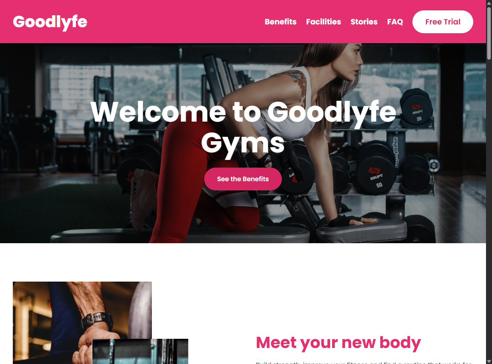
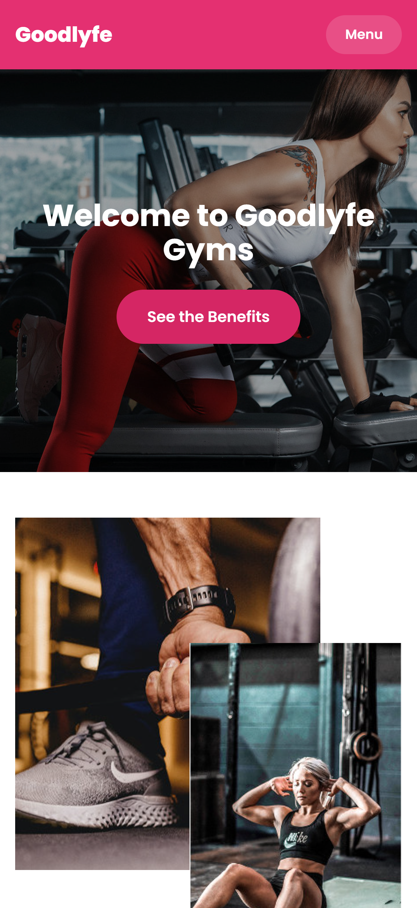

# Goodlyfe

Адаптивный лендинг фитнес-студии: вёрстка по макету из Figma на чистых HTML, CSS и JavaScript, без фреймворков.

**[Открыть демо](https://beta-banana.github.io/goodlyfe-landing/)** · [Макет в Figma](https://www.figma.com/file/blZiGoVk9nmSLALjMVsGMy/GoodLyfe-Landing-Page-Template?node-id=0%3A1)

  
  

## Возможности

- Адаптивная вёрстка: десктоп, планшет, мобильные устройства
- Мобильное меню: закрывается кнопкой, по `Esc` и после выбора раздела
- FAQ на `
` / `
`, работает без JavaScript
- Форма пробного занятия с валидацией обязательных полей и email (демо, данные не отправляются)
- Горизонтальная прокрутка отзывов на мобильных экранах

## Что я здесь отработал

| Тема | Реализация |
|---|---|
| Раскладка | Flexbox и Grid |
| Перекрывающиеся фото | `position: absolute` внутри контейнеров с `position: relative` |
| Адаптивность | медиазапрос до 768 px + отдельные настройки шапки на 769–900 px |
| Меню | состояние через атрибут `hidden`, `aria-expanded` для скринридеров |
| Доступность | подписи к полям формы, видимый `:focus-visible` у интерактивных элементов |

## Запуск

Откройте `index.html` в браузере или запустите папку через Live Server в VS Code. Сборка и зависимости не нужны.

Шрифт Poppins подключается через Google Fonts, запасной вариант — Arial.

## О проекте

Учебная работа для портфолио. FAQ и форму пробного занятия я добавил к исходному макету сам. Серверной части нет, истории в отзывах вымышлены, ссылки на соцсети и магазины приложений ведут на главные страницы сервисов, email указан для примера.

Макет: [Figma](https://www.figma.com/file/blZiGoVk9nmSLALjMVsGMy/GoodLyfe-Landing-Page-Template?node-id=0%3A1) · [страница шаблона](https://www.freefigmatemplates.com/gallery/goodlyfe-gym-landing-page-ui-kit)